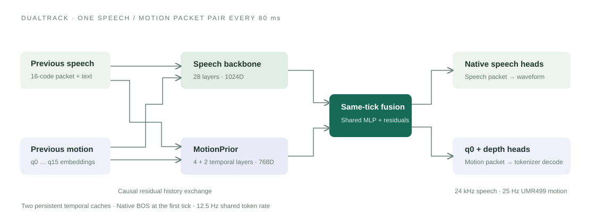

<div align="center">

# DualTrack

### Synchronized Speech–Gesture Generation via Symmetric Coupling of Pretrained Priors

**[▶ Interactive demo](https://yuanzhuo2021.github.io/DualTrack/demo/)** · **[Checkpoints](https://github.com/Yuanzhuo2021/DualTrack/releases/tag/v1.0.0)** · **[Quick start](#quick-start)** · **[Architecture](#architecture)**

A shared 12.5 Hz clock. Two autoregressive backbones. One synchronized speech–motion stream.

</div>



DualTrack generates speech and co-speech gestures by coupling a pretrained speech generator with a hierarchical **MotionPrior**. The speech and motion models retain their own temporal backbones and native packet heads. Lightweight residual modules exchange information from the **previous generated packets**, then fuse the **current hidden states** before both modalities predict their next packets.

This repository contains the **core model architectures, inference and evaluation code, fixed checkpoints, and comparison videos**. It does not include training scripts, optimization schedules, or dataset preprocessing pipelines.

## Demo

**[Open the interactive comparison website →](https://yuanzhuo2021.github.io/DualTrack/demo/)**

The site supports language/model filters, transcript search, pagination, and one-at-a-time playback. It includes both the original comparison renders and the perceptual-study media, with the original audio and timing preserved.

| Language | DualTrack | GELINA | Perceptual-study triplets |
| --- | ---: | ---: | ---: |
| English | 22 | 22 | 22 |
| Spanish | 6 | 6 | 6 |
| Chinese | 9 | — | — |
| Japanese | 6 | — | — |
| **Total** | **43** | **28** | **28** |

Each perceptual-study triplet contains **ground truth, GELINA, and DualTrack**, with combined audio/video, motion-only video, and speech-only audio. The public gallery shows source labels; it is a media viewer, not an anonymous rating service.

For offline browsing, open [`demo/index.html`](demo/index.html), or run `python -m http.server 8000 --bind 127.0.0.1` in the repository root and visit `http://127.0.0.1:8000/demo/`.

## Architecture

The system has three components:

1. **Motion tokenizer:** encodes continuous motion into semantic and kinematic discrete codes and reconstructs motion from predicted codes.
2. **MotionPrior:** models the temporal evolution and within-packet hierarchy of those motion codes.
3. **DualTrack:** couples the speech backbone and MotionPrior through causal history exchange and same-tick residual fusion.

### 1. Motion tokenizer

**Code:** [`tokenizer/models/umr/structured_vq.py`](tokenizer/models/umr/structured_vq.py), [`conv_backbone.py`](tokenizer/models/umr/conv_backbone.py), and [`split_semantic_rvq.py`](tokenizer/models/quantizers/split_semantic_rvq.py).

The tokenizer accepts **25 Hz UMR499 motion features**. A convolutional encoder with temporal stride 2 maps them to **512-dimensional latents at 12.5 Hz**. A split quantizer produces one semantic code and fifteen kinematic codes per token frame:

```text
25 Hz motion [B, 499, T]
        │ convolutional encoder, stride 2
        ▼
12.5 Hz latent [B, T/2, 512]
        ├── semantic projection → single VQ ─────────── q0
        └── kinematic projection → 15-layer RVQ ───── q1 … q15
                          │
               sum projected quantized latents
                          ▼
                  convolutional decoder
                          ▼
                 reconstructed 25 Hz motion
```

Both quantization branches operate on learned projections of the **full encoder latent**. The kinematic branch is not computed by subtracting the semantic quantization first. Their output projections are summed for reconstruction. Every codebook has **1,024 entries**, and each packet has shape `[16]`.

The 499D representation contains 9 root-trajectory features, 6 root-rotation features, 456 local joint-rotation features, 24 sparse-velocity features, and 4 foot-contact channels. Normalization statistics are embedded in the checkpoint. Reconstruction exports physical-unit motion features; foot-contact channels remain decoder logits.

The included tokenizer uses noncausal convolutions. Token-by-token generation in the prior does not imply a causal, zero-lookahead motion decoder.

### 2. MotionPrior

**Code:** [`motionprior/motionprior/models/motion_prior.py`](motionprior/motionprior/models/motion_prior.py), [`frame_embedding.py`](motionprior/motionprior/models/frame_embedding.py), [`temporal_gpt.py`](motionprior/motionprior/models/temporal_gpt.py), and [`depth_gpt.py`](motionprior/motionprior/models/depth_gpt.py).

MotionPrior predicts a packet of 16 motion codes at each 80 ms tick. Its packet embedding explicitly separates semantic and kinematic information:

- **Semantic history:** the frozen `q0` codebook embedding is projected and normalized into a 768D representation.
- **Kinematic history:** each of the fifteen remaining codebook embeddings receives its own 96D projection. These projections are concatenated, normalized, and mapped to 768D.
- **Full-motion history:** the semantic and kinematic representations are concatenated and fused into the full-motion temporal input.

Two temporal stacks process these histories: a **4-layer full-motion transformer** and a **2-layer semantic transformer**. The semantic state predicts `q0`; the full-motion state and a projected semantic state form the context for a **3-layer depth transformer**, which predicts `q1` through `q15` autoregressively within each packet.

The semantic `q0` prediction is factorized into a **stay/change decision** and a **new-code distribution**. This explicitly represents repetition of the previous semantic code. BOS is a dedicated all-1024 packet and never enters the tokenizer decoder as a normal code.

| Property | Released checkpoint |
| --- | --- |
| Checkpoint step | 861,853 |
| Hidden width | 768 |
| Full-motion / semantic temporal layers | 4 / 2 |
| Depth layers | 3 |
| Attention heads | 12 |
| Feed-forward width | 2,304 |
| Motion packet | 16 × 1,024-way codes |
| Temporal context | 150 ticks, or 12 seconds |
| Token rate | 12.5 Hz |

Standalone MotionPrior inference can begin from BOS or continue a provided motion-token prefix. It models motion without requiring speech. In DualTrack, projected previous-speech embeddings condition both motion temporal streams.

### 3. DualTrack coupling

**Code:** [`dualtrack/DualTrack/dual_tick.py`](dualtrack/DualTrack/dual_tick.py), [`motionprior.py`](dualtrack/DualTrack/motionprior.py), and [`qwen.py`](dualtrack/DualTrack/qwen.py).

The speech side uses **Qwen3-TTS-12Hz-0.6B-Base**: a 28-layer, 1024D temporal backbone and its native speech-code heads. Each speech packet contains 16 codes. The motion side is the complete MotionPrior described above.

#### Causal history exchange

At tick `t > 0`, the previous motion packet is embedded and projected into the next speech input. In the other direction, the previous speech packet embedding is projected into a condition for the motion temporal backbones:

```text
speech input at t = native speech/text input + R_motion_to_speech(E_motion(m[t-1]))
motion condition at t = R_speech_to_motion(E_speech(s[t-1]))
```

Each cross-modal residual is `LayerNorm → Linear → SiLU → Linear`, with a 512D intermediate width. The output projection is initialized to zero by the model constructor; the released coupling checkpoint supplies the learned parameters.

At the first tick, both modalities use their native BOS behavior and cross-input residuals are suppressed. The two models therefore start from their own valid initial states.

#### Same-tick fusion

After both temporal backbones advance, a shared MLP receives the normalized speech hidden state and the semantic motion hidden state:

```text
z[t] = SiLU(W_f · concat(LN(h_s[t]), LN(h_m[t])))
h_s_fused[t] = h_s[t] + W_s · z[t]
h_m_fused[t] = h_m[t] + W_m · z[t]
```

`z[t]` has width 512. The two residual outputs return to the native dimensions: 1024 for speech and 768 for motion. The fused speech state drives the native speech packet heads. The fused motion state drives `q0` and contributes to the depth context together with the full-motion temporal state.

This is **symmetric coupling**: history exchange runs in both directions, and same-tick fusion produces residuals for both modalities. It is not a single shared temporal transformer.

#### Generation and decoding

[`DualTickStream`](dualtrack/DualTrack/dual_tick.py) maintains two temporal cache owners: the speech backbone and the motion prior. The motion prior internally keeps separate full-motion and semantic key/value caches. Its 150-tick context is rebuilt from the recent history when necessary.

A generation iteration advances both backbones, performs fusion, predicts a speech packet and a motion packet, and stores them for the next tick. Speech EOS terminates the joint stream. Speech and motion sampling use independently seeded random-number streams.

The inference wrapper then decodes the complete token sequences into **24 kHz speech** and **25 Hz UMR499 motion**. The demo videos are separately rendered at **30 FPS**. These three rates describe different representations.

The current DualTrack stream accepts legacy text-feature arguments for interface compatibility, but its generation state does not consume Flan features. **Flan-T5 is not required for this inference release.** The provided end-to-end command uses a reference-audio speaker embedding; it is not a separate text-only speaker-conditioning implementation.

## Repository map

```text
tokenizer/
  models/                   Encoder, decoder, semantic/kinematic quantizers
  data/                     UMR representation and evaluation utilities
  eval/                     Reconstruction, codebook, and geometry metrics
  inference.py              Encode and reconstruct a UMR499 clip
  evaluate.py               Evaluate a manifest of clips
  checkpoints/best.pt        Downloaded from the release
motionprior/
  motionprior/models/       Packet embeddings, temporal stacks, depth prediction
  motionprior/contracts/    Exact tokenizer contract
  inference.py              BOS/prefix-conditioned motion generation
  evaluate.py               Teacher-forced token NLL and accuracy
  checkpoints/step861853.pt  Downloaded from the release
dualtrack/
  DualTrack/                Two-backbone model, coupling, cached generation
  joint_motion/             Shared sampling and paired-evaluation primitives
  third_party/Qwen3-TTS/     Required upstream model/inference source
  inference.py              Text + reference voice → speech + motion
  evaluate.py               Paired speech/motion token losses
  checkpoints/step_013000.pt Downloaded from the release
demo/                       Static website and all comparison/study media
```

Module-specific details: [Tokenizer](tokenizer/README.md) · [MotionPrior](motionprior/README.md) · [DualTrack](dualtrack/README.md).

## Checkpoints

The checkpoint files are **Release assets**, not Git objects. Clone the code, then run:

```bash
python download_checkpoints.py
```

| Component | Download | Installed path |
| --- | --- | --- |
| Tokenizer | [tokenizer_best.pt](https://github.com/Yuanzhuo2021/DualTrack/releases/download/v1.0.0/tokenizer_best.pt) | `tokenizer/checkpoints/best.pt` |
| MotionPrior | [motionprior_step861853.pt](https://github.com/Yuanzhuo2021/DualTrack/releases/download/v1.0.0/motionprior_step861853.pt) | `motionprior/checkpoints/step861853.pt` |
| DualTrack | [dualtrack_step013000.pt](https://github.com/Yuanzhuo2021/DualTrack/releases/download/v1.0.0/dualtrack_step013000.pt) | `dualtrack/checkpoints/step_013000.pt` |

[`CHECKPOINTS.json`](CHECKPOINTS.json) records exact file sizes and SHA256 hashes. The downloader checks both before installing a file. `--model tokenizer`, `--model motionprior`, or `--model dualtrack` downloads one component.

The DualTrack checkpoint contains **updated parameters relative to the frozen bases**, not a standalone copy of every model. Use all three listed checkpoints together with the original Qwen base and speech tokenizer. Checkpoint bytes and parameter keys are unchanged by the public package renaming; serialized historical metadata is retained for compatibility.

## Quick start

### Environment

Python **3.12** is the tested environment. Keep the three model directories next to one another so relative tokenizer and prior paths resolve correctly.

```bash
git clone https://github.com/Yuanzhuo2021/DualTrack.git
cd DualTrack
python -m venv .venv
source .venv/bin/activate
pip install -r requirements.txt
python download_checkpoints.py
```

For GPU execution, use a compatible PyTorch/CUDA installation. Every command also accepts `--device cpu` for small checks.

### Tokenizer reconstruction

```bash
cd tokenizer
python inference.py --checkpoint checkpoints/best.pt \
  --input /path/to/umr499.npz --out outputs/reconstruction.npz --device cpu
```

The input follows [`UMR499`](tokenizer/data/umr_schema.py), including continuous features, its canonical anchor, and associated metadata. Use **25 Hz** motion for the included checkpoint. The output includes the original/reconstructed features and `[T_token, 16]` code indices.

### Motion generation

```bash
cd motionprior
python inference.py --ticks 96 --device cpu --out outputs/motion.npz

# Optional prefix-conditioned continuation:
python inference.py --prefix /path/to/prefix.npz --ticks 96 \
  --temperature 0.6 --top-k 20 --seed 123 \
  --device cuda:0 --out outputs/continuation.npz
```

Run each example from its named directory under the repository root. The output contains `motion_codes`, `features`, `fps=25`, and `token_hz=12.5`. Prefix continuation exports the newly generated portion only.

### Synchronized speech and gesture

Obtain the **[Qwen3-TTS-12Hz-0.6B-Base](https://huggingface.co/Qwen/Qwen3-TTS-12Hz-0.6B-Base)** model directory from its official distribution. It must include its configuration, text tokenizer files, `model.safetensors`, and the complete `speech_tokenizer/` subdirectory. The runtime verifies the exact base-weight hashes in [`base_locks.json`](dualtrack/base_locks.json); this base is not duplicated in the Release assets.

```bash
cd dualtrack
python inference.py \
  --text "Hello, how are you?" --language english \
  --reference-audio /path/to/reference.wav \
  --qwen-dir /path/to/Qwen3-TTS-12Hz-0.6B-Base \
  --device cuda:0 --ticks 150 --seed 123 \
  --out-dir outputs/example
```

Languages: `english`, `spanish`, `chinese`, and `japanese`. Use `--greedy` for greedy decoding. `DUALTRACK_QWEN_DIR` can replace `--qwen-dir`; otherwise the loader looks under `external/Qwen3-TTS-12Hz-0.6B-Base` at the repository root.

Outputs are `speech.wav`, `motion.npz`, and `result.json`. The motion NPZ contains **UMR499 features and the generated speech/motion codes**, not SMPL-X pose parameters. Converting it to a rendered character requires the appropriate anchor, identity, and external body-model assets.

## Evaluation

| Component | Included evaluation | Additional inputs |
| --- | --- | --- |
| Tokenizer | Feature MAE/MSE, foot-contact F1, codebook statistics; optional geometry gates | UMR NPZ manifest; external body model for geometry gates |
| MotionPrior | Per-codebook teacher-forced NLL and accuracy | Reference motion-token NPZ |
| DualTrack | Teacher-forced speech loss, motion loss, and total loss | Aligned paired tokens and a cached conditioning PT |

Examples, from each component directory:

```bash
# tokenizer/
python evaluate.py --codec-mode vq_vae --checkpoint checkpoints/best.pt \
  --manifest /path/to/eval_manifest.txt --gates L1,L3 \
  --device cpu --out outputs/eval.json

# motionprior/
python evaluate.py --input /path/to/reference_tokens.npz \
  --device cpu --out outputs/token_metrics.json

# dualtrack/
python evaluate.py --condition /path/to/condition.pt \
  --tokens /path/to/paired_tokens.npz \
  --qwen-dir /path/to/Qwen3-TTS-12Hz-0.6B-Base \
  --device cuda:0 --out outputs/eval.json
```

MotionPrior evaluation uses disjoint windows of at most 150 ticks, retains the actual previous token at each boundary, and resets earlier attention history. DualTrack paired evaluation accepts 1–149 ticks and does not add a natural-EOS target. These are core model checks; the full paper FGD, ASR, mesh-fitting, and human-rating pipelines are not included.

## Verification and provenance

The release is checked with small CPU inference/evaluation runs, checkpoint SHA256 checks, namespace/import checks, and demo media/link checks. The renamed DualTrack model is compared against the original implementation on a fixed paired input. See [`VERIFICATION.json`](VERIFICATION.json) for the checks actually completed.

This is an inference release: there are no training entry points, optimizer setup scripts, or dataset-building scripts. Standard model `forward` and `train()`/`eval()` branches remain where required by the original architecture and evaluation.

Third-party source retains its notices and accompanying licenses. See [`NOTICE.md`](NOTICE.md). The demo uses the archived outputs; the media have not been regenerated or replaced with foot/pelvis-constrained variants.
