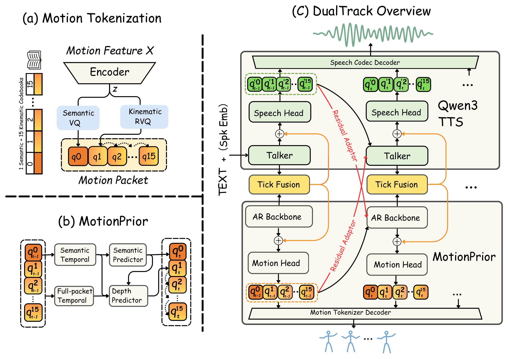

<div align="center">

# DualTrack

### Synchronized Speech–Gesture Generation via Symmetric Coupling of Pretrained Priors

**[Interactive demo](https://yuanzhuo2021.github.io/DualTrack/demo/)** · **[Checkpoints](https://github.com/Yuanzhuo2021/DualTrack/releases/tag/v1.0.0)** · **[Quick start](#quick-start)**

</div>

DualTrack generates synchronized speech and expressive body and finger gestures from text. It couples pretrained Qwen3-TTS and MotionPrior on a shared 12.5 Hz timeline, using bidirectional history exchange and **Tick Fusion** to coordinate the two streams.

## Demo

**[Open the interactive skeleton comparison →](https://yuanzhuo2021.github.io/DualTrack/demo/)**

Compare **GT (ground truth), GELINA, and DualTrack** with front and side skeleton views and corresponding audio. The gallery contains 43 BEAT2 samples across English, Spanish, Chinese, and Japanese, with language/source filters and transcript search. GT and DualTrack cover all 43 samples; GELINA covers the 28 English/Spanish samples.

## Architecture

[](demo/assets/architecture.pdf)

### 1. Motion tokenizer

The **SeMoCo-based tokenizer** represents 25 Hz body and finger motion using one semantic code and fifteen kinematic codes per 12.5 Hz packet. Its decoder reconstructs continuous motion from these codes. [Code and usage →](tokenizer/README.md)

### 2. MotionPrior

Pretrained on motion-only data, **MotionPrior** models semantic and full-packet histories separately. It predicts the next semantic code, then completes the fifteen kinematic codes with a depth predictor. [Code and usage →](motionprior/README.md)

### 3. DualTrack coupling

**Residual adapters** exchange previous speech and motion packets in both directions. **Tick Fusion** combines the current speech and motion-semantic states, after which the two streams complete their own packets in parallel. [Code and usage →](dualtrack/README.md)

## Quick start

Python 3.12 is the tested environment. Install the dependencies and download all three checkpoints:

```bash
git clone https://github.com/Yuanzhuo2021/DualTrack.git
cd DualTrack
python -m venv .venv
source .venv/bin/activate
pip install -r requirements.txt
python download_checkpoints.py
```

Obtain the official **[Qwen3-TTS-12Hz-0.6B-Base](https://huggingface.co/Qwen/Qwen3-TTS-12Hz-0.6B-Base)** model, including its `speech_tokenizer/` directory. Then generate speech and gesture from text and a reference voice:

```bash
cd dualtrack
python inference.py \
  --text "Hello, how are you?" --language english \
  --reference-audio /path/to/reference.wav \
  --qwen-dir /path/to/Qwen3-TTS-12Hz-0.6B-Base \
  --device cuda:0 --ticks 150 --seed 123 \
  --out-dir outputs/example
```

Supported languages: `english`, `spanish`, `chinese`, and `japanese`. Outputs are `speech.wav`, `motion.npz` (25 Hz UMR499 motion and generated codes), and `result.json`. The inference command uses a reference speaker embedding; rendering the motion requires external body-model assets.

For standalone reconstruction, motion generation, and evaluation, see the [Tokenizer](tokenizer/README.md), [MotionPrior](motionprior/README.md), and [DualTrack](dualtrack/README.md) guides.

## Checkpoints

The [release](https://github.com/Yuanzhuo2021/DualTrack/releases/tag/v1.0.0) provides:

- **Tokenizer:** `tokenizer/checkpoints/best.pt`
- **MotionPrior:** `motionprior/checkpoints/step861853.pt`
- **DualTrack:** `dualtrack/checkpoints/step_013000.pt`

The downloader verifies the sizes and hashes in [CHECKPOINTS.json](CHECKPOINTS.json). DualTrack uses all three checkpoints plus the external Qwen base.

## Release notes

This repository includes model architectures, inference, evaluation, checkpoints, and demo media. Training and dataset preparation pipelines are not included. See [VERIFICATION.json](VERIFICATION.json) for completed checks and [NOTICE.md](NOTICE.md) for third-party notices.

To browse the demo locally, open [demo/index.html](demo/index.html) or serve the repository with `python -m http.server 8000 --bind 127.0.0.1` and visit `http://127.0.0.1:8000/demo/`.
